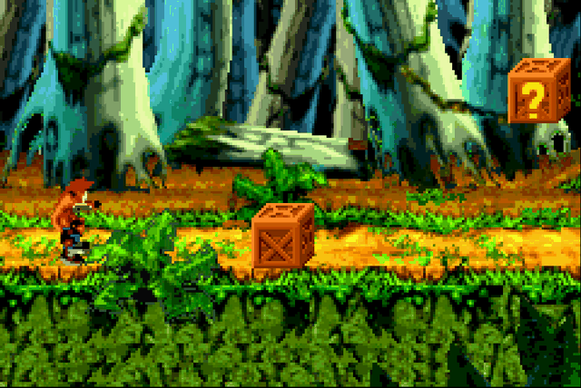
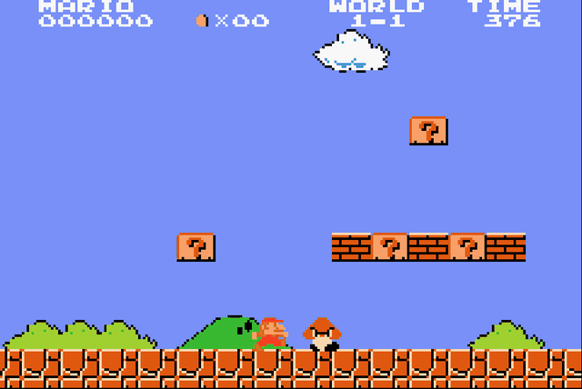
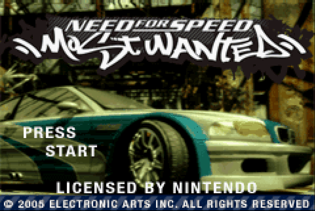
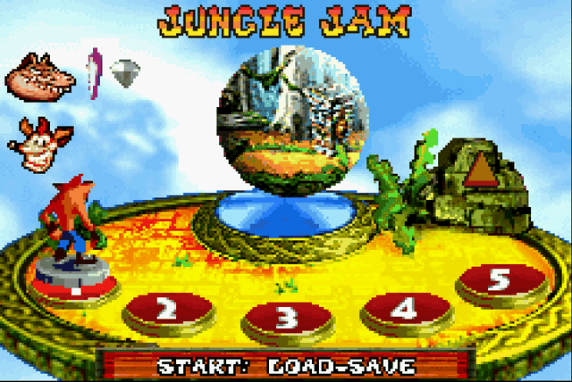
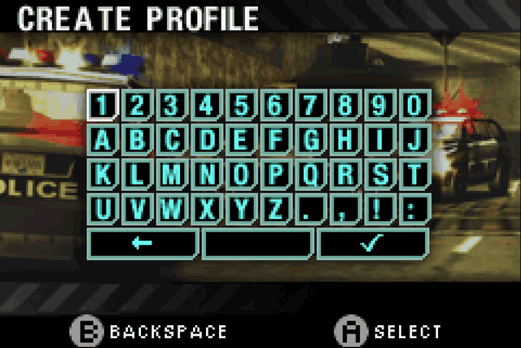
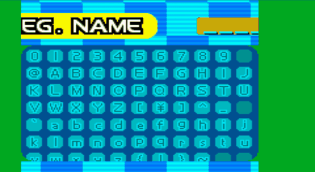

# GBA-emulator-console

Emulador de **Game Boy Advance** escrito en Rust, para escritorio y web. Es el segundo paso de una serie
(NES → GBA → Nintendo DS): continúa el trabajo de [replica-NES](https://github.com/DEIMER-PY/replica-NES)
y prepara el terreno para la DS, que reutiliza la misma CPU (ARM7TDMI).

> **Estado:** funciona en escritorio (Windows y Linux) y en el navegador; probado con cuatro juegos
> comerciales (ver [Probado con](#probado-con)). Ver [docs/ROADMAP.md](docs/ROADMAP.md).

| <br><sub>Crash Bandicoot</sub> | <br><sub>Super Mario Bros.</sub> | <br><sub>Need for Speed: Most Wanted</sub> |
|:---:|:---:|:---:|
| <br><sub>Crash — mapa de niveles</sub> | <br><sub>NFS — crear perfil</sub> | <br><sub>Estirada y suavizada</sub> |

## Funcionalidades

- Emulación completa de la GBA con `rustboyadvance-ng` y BIOS libre incluida.
- Pantalla de inicio con biblioteca de juegos, recientes, arrastrar y soltar y línea de comandos.
- Teclado y **mandos** USB o Bluetooth, con teclas y botones reasignables.
- Sonido con volumen y silencio.
- Pausa, reinicio, avance rápido y save states en 4 ranuras.
- Partidas guardadas (SRAM, Flash y EEPROM) en disco, automáticamente.
- Imagen: escalado entero, estirar, suavizado, líneas de barrido, giro de 90°/180°/270° y pantalla completa.
- Escritorio (Windows y Linux, ejecutables en Releases) y navegador (WebAssembly).

## Probado con

| Juego | Hasta dónde se probó | Windows | Linux |
|---|---|:---:|:---:|
| [Crash Bandicoot: The Huge Adventure](docs/capturas/crash.png) | Intro, mapa de niveles y primer nivel jugando (en Linux, hasta el menú de partidas) | ✅ | ✅ |
| [Classic NES Series: Super Mario Bros.](docs/capturas/smb.png) | Nivel 1-1 jugando | ✅ | ✅ |
| [Need for Speed: Most Wanted](docs/capturas/nfs.png) | Selección de idioma, título y creación de perfil | ✅ | — |
| [Sonic Advance 3](docs/capturas/sonic3.png) | Arranque y registro de nombre | ✅ | — |

Detalles, método y limitaciones conocidas en [docs/PRUEBAS.md](docs/PRUEBAS.md).

## Tecnologías

| Pieza | Tecnología |
|---|---|
| Lenguaje | Rust 2024 (estable) |
| Emulación | [`rustboyadvance-ng`](https://github.com/michelhe/rustboyadvance-ng) — CPU ARM7TDMI, PPU, APU, DMA, timers y cartucho; copia en `vendor/`, con parches documentados en `PARCHES.md` |
| BIOS | [Cult-of-GBA](https://github.com/Cult-of-GBA/BIOS), libre e incluida: no hace falta la de Nintendo |
| Ventana e interfaz | `eframe` / `egui` 0.37, render con `wgpu` (Vulkan, DirectX 12, Metal o WebGL2) |
| Audio | `cpal` 0.18; el core genera las muestras a la frecuencia de la tarjeta (`set_sample_rate`) |
| Mandos | `gilrs` 0.11: mandos USB y Bluetooth (XInput, DirectInput, evdev), botones reasignables |
| Diálogo de archivos | `rfd` |
| Configuración | `serde` + `ron`, guardada por `eframe` en la carpeta de datos del usuario |
| Icono del ejecutable | `winresource` (incrusta `assets/icon.ico` en el `.exe` de Windows) |
| Web | `trunk` + `wasm32-unknown-unknown`, `wasm-bindgen` y `web-sys` |
| CI y publicación | GitHub Actions: formato, `clippy`, tests, compilación web y ejecutables de Windows y Linux (Ubuntu 22.04, glibc 2.35) que se abren 15 s en la CI antes de publicarse |

## Qué hay

- **`crates/gba-app`** — la aplicación: ventana, pantalla de inicio con biblioteca, teclado y mandos
  reasignables, sonido, pausa, avance rápido, save states y ajustes. Portada de replica-NES.
- **`crates/gba-core`** — API de emulación: cargar una ROM, emular frame a frame, imagen 240×160, audio
  estéreo, botones, save states y partidas guardadas. Sin acceso a disco, lista para escritorio y web.
- **`vendor/rustboyadvance-ng`** — el core que hace el trabajo (CPU ARM7TDMI, PPU, APU, DMA, timers,
  cartucho), tomado de [rustboyadvance-ng](https://github.com/michelhe/rustboyadvance-ng) y parcheado.
- **BIOS libre incluida** ([Cult-of-GBA](https://github.com/Cult-of-GBA/BIOS)): no hace falta la BIOS de Nintendo.

## Usarlo

Requiere [Rust](https://rustup.rs) estable (≥ 1.95).

```sh
cargo run -p gba-app --release                      # abre la app
cargo run -p gba-app --release -- ruta/juego.gba    # ...con un juego
cargo test --workspace                              # tests
cargo run -p gba-core --release --example bench     # velocidad del core (~10x la real)
```

Controles por defecto: flechas, `X` = A, `Z` = B, `A` = L, `S` = R, `Enter` = Start, `Retroceso` = Select.
Todo lo demás está en [docs/USO.md](docs/USO.md).

## Documentación

| Documento | Contenido |
|---|---|
| [docs/INSTALACION.md](docs/INSTALACION.md) | Ejecutable o compilación, requisitos y dónde conseguir ROMs |
| [docs/USO.md](docs/USO.md) | Cómo usar la app: cargar juegos, controles, guardado, sonido e imagen |
| [docs/WEB.md](docs/WEB.md) | Versión web: compilar con `trunk`, diferencias con el escritorio |
| [docs/PRUEBAS.md](docs/PRUEBAS.md) | Juegos probados en Windows y Linux, capturas y limitaciones conocidas |
| [docs/ARQUITECTURA.md](docs/ARQUITECTURA.md) | Diagramas, Capas, API de `gba-core`, funcionamiento de la app, decisiones de diseño |
| [docs/REFERENCIAS.md](docs/REFERENCIAS.md) | Cores, tests, documentación y herramientas evaluados; por qué se eligió cada uno |
| [docs/ROADMAP.md](docs/ROADMAP.md) | Qué está hecho, qué falta y el plan hacia la Nintendo DS |
| [docs/GUIA-DESARROLLO.md](docs/GUIA-DESARROLLO.md) | Entorno, comandos, flujo de ramas y convención de commits |
| [CHANGELOG.md](CHANGELOG.md) | Cambios por versión |

## Licencia

[MIT](LICENSE). El código de terceros conserva su licencia (también MIT): ver
[`vendor/rustboyadvance-ng`](vendor/rustboyadvance-ng/PARCHES.md) y
[`crates/gba-core/bios`](crates/gba-core/bios/LICENSE-cult-of-gba).

No se incluyen ni se distribuyen ROMs comerciales ni la BIOS de Nintendo.
