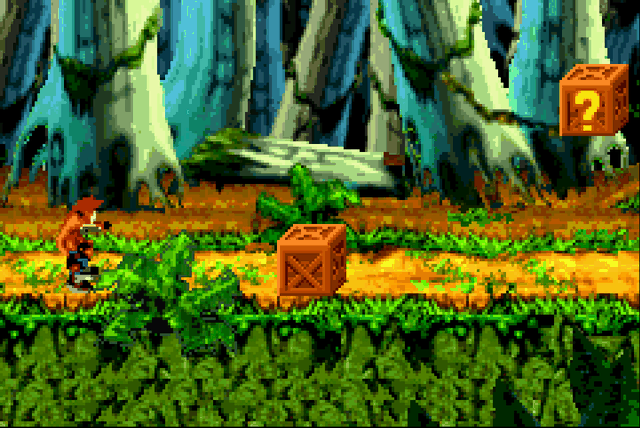
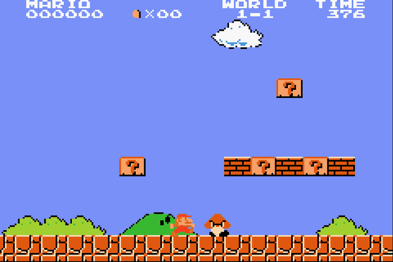
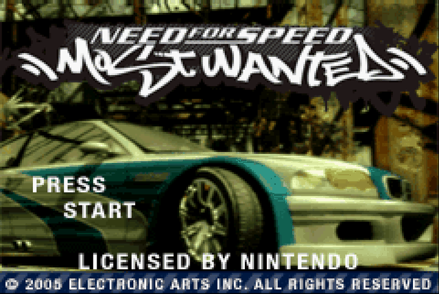
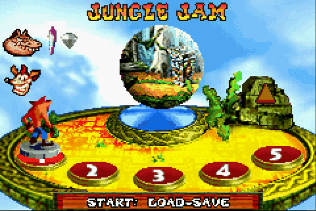
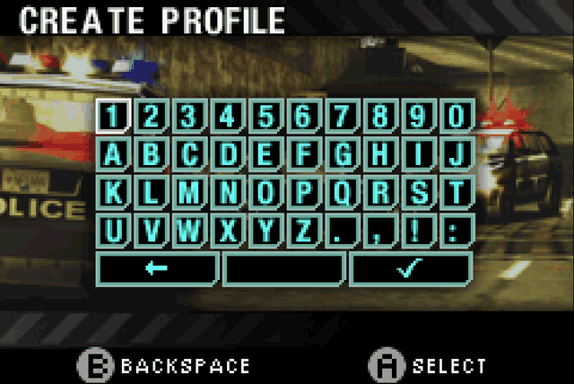
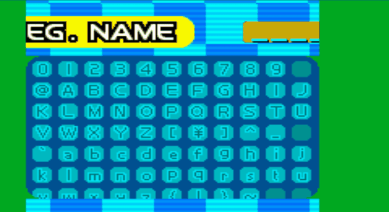

# Pruebas con juegos

Registro de las pruebas manuales con juegos comerciales de la Game Boy Advance. Complementan los tests
automáticos (`cargo test --workspace`), que usan la ROM de demostración del proyecto, y la prueba de la CI,
que abre cada ejecutable publicado durante 15 segundos antes de subirlo a la release.

Las ROMs son volcados propios y **no están en el repositorio**.

## Resultado

| Juego | Hasta dónde se probó | Windows | Linux |
|---|---|:---:|:---:|
| [Crash Bandicoot: The Huge Adventure](capturas/crash.png) | Intro, mapa de niveles y primer nivel jugando (en Linux, hasta el menú de partidas) | ✅ | ✅ |
| [Classic NES Series: Super Mario Bros.](capturas/smb.png) | Nivel 1-1 jugando | ✅ | ✅ |
| [Need for Speed: Most Wanted](capturas/nfs.png) | Selección de idioma, título y creación de perfil | ✅ | — |
| [Sonic Advance 3](capturas/sonic3.png) | Arranque y registro de nombre | ✅ | — |

✅ funciona hasta ese punto · — no probado en ese sistema

## Cómo se probó

- **Windows 11:** el ejecutable compilado por la CI (`release.yml`), con la ROM pasada por línea de comandos.
  Un script de PowerShell pulsa teclas con `keybd_event` y captura la ventana.
- **Linux:** el mismo binario de Linux de la CI, en Ubuntu 24.04 (WSL2) con un servidor X virtual (`Xvfb`).
  Las teclas se envían con `xdotool` y las capturas se hacen con ImageMagick (`import`).
- Los mandos no se probaron con hardware: solo teclado.

## Capturas

|  Crash Bandicoot |  Super Mario Bros. |  Need for Speed: Most Wanted |
|:---:|:---:|:---:|
|  Crash — mapa de niveles |  NFS — crear perfil |  Estirada y suavizada |

## Limitaciones conocidas

- Need for Speed: Most Wanted y Sonic Advance 3 se probaron hasta sus menús (perfil y registro de nombre); no se llegó a una carrera ni a un nivel.
- Los mandos están implementados (`gilrs`, con reasignación en **Ajustes → Controles**) pero no se han probado con un mando físico.
- La BIOS libre no muestra la animación de arranque de Nintendo: los juegos empiezan directamente.

## Fallo encontrado y corregido

Las primeras pruebas con los ejecutables publicados fallaron con **los cuatro juegos**: se colgaban en la
primera llamada a la BIOS con «error de emulación». En modo debug funcionaban.

La protección de lectura de la BIOS consultaba el contador de programa de la CPU a través de un puntero
crudo mientras la CPU tenía un `&mut self` activo. Con LTO completo el compilador reordenaba la lectura y
el bus veía un PC antiguo, así que la CPU ejecutaba la instrucción equivocada en el vector de la SWI. La
corrección (en `vendor/rustboyadvance-ng`, ver `PARCHES.md`) hace que la CPU publique su estado de búsqueda
en el bus de forma explícita. Tres tests (`swi`) lo cubren y la CI los ejecuta en modo release.
